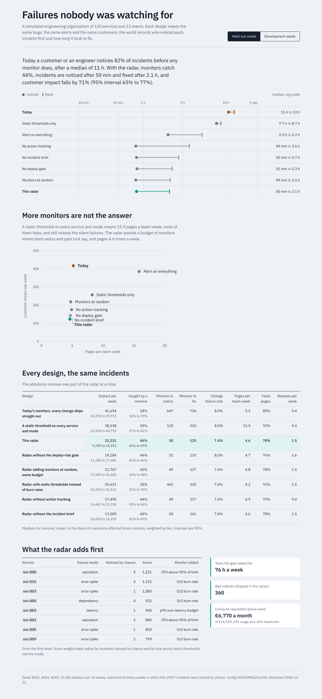

# silent-failure-radar

Finds the failures nobody is watching for, puts monitors on them that page the team that owns the service, and gates risky deploys behind tests, a feature flag and a canary. Java 21 and Spring Boot for the service, Go for the CI command, Datadog monitors as code (JSON and Terraform).

It is built for the job an operational-excellence team does across a large engineering organisation: fewer incidents, noticed sooner, recovered faster, and not repeated. The radar does four things:

1. **Coverage gaps.** It reads the service catalog, the call graph, the monitors that exist and the incident history. It ranks every (service, failure mode) pair nobody watches by blast radius (tier and dependents), by how often incidents there were noticed by chance, and by whether the mode is one that static thresholds miss (silent drops, slow latency creep). Each team has a monitor budget, so the ranking decides what gets added first.
2. **Monitors as code, routed to owners.** Each gap becomes a Datadog monitor. Error and dependency failures get an SLO burn-rate alert that pages when the last hour burns the error budget 14.4 times faster than allowed (the fast-burn threshold from the SRE workbook), so a blip does not page and an outage pages in minutes. Silent drops in business metrics get an anomaly monitor that also alerts when the metric stops reporting. Every monitor carries `service:`, `team:`, `tier:` and `mode:` tags, notifies the owning team's channel and, for tier 1, its PagerDuty. They are exported as Datadog API JSON and as Terraform `datadog_monitor` resources, and `radar lint` checks them in CI before they are applied.
3. **Deploy-risk gate.** A logistic model trained on eight weeks of deploy history (untested changed lines, change size, untested share, the service's blast radius and its incidents in the last four weeks) scores each change. Low risk ships; medium risk goes to a 5% canary with automatic rollback (the service emits the Istio `VirtualService` and `DestinationRule` for the split); high risk must add tests for the untested lines and ship behind a flag and a canary. `radar gate` asks the service from the pipeline and fails the build only when tests or a flag are missing. If the radar is down, the pipeline falls back to a canary instead of blocking every team.
4. **Incident brief and follow-through.** When Datadog fires, the webhook builds a brief for whoever is on call: the deploys to that service and its dependencies in the last three hours, ranked as suspects; earlier incidents with the same fingerprint and the actions they left open. Actions are tracked, so recurrences fall. A cost lens shows requested compute above p95 usage plus 20% headroom, per team.

## Results

The organisation is simulated: 120 services owned by 12 teams, with a call graph, deploys, bugs that depend on untested code and on a complexity the radar never sees, monitors that fire falsely, customers who notice first, and engineers who slow down when they are paged too often. Every design runs on the same seeds with the same random draws, so differences come from the design and not from luck. Gates were set on development seeds; the held-out seeds were run once.

<!-- results:start -->
_From the held-out seeds, run once; generated by `./gradlew :eval:readme`._

Against today's monitors and straight-to-production deploys, the radar cut customer impact by **71%** (95% interval 65%–77%). Monitors caught 44% of incidents instead of 18%, median time to notice fell from 647 to 50 minutes and to recover from 754 to 125 minutes, and changes failed 7.4% of the time instead of 8.0%. Teams got 4.6 pages a week, 78% of them false; putting a static threshold on everything would mean 15.9 pages a week, 92% false.

Seeds 8101, 8102, 8103 · 120 services and 12 teams per seed · 17,283 deploys over 16 live weeks · trained on 8 history weeks in which 691 of 817 recorded incidents were noticed by a customer or an engineer first · config `101f5399eb211d9d`. Intervals are 95%, resampling whole weeks.

| Design | Customer impact per week | Caught by a monitor | Median minutes to notice | Median minutes to recover | Change failure rate | Pages per team-week | False pages | Recurrences per week |
|---|---|---|---|---|---|---|---|---|
| Today's monitors, every change ships straight out | 41,694 (36,370–47,913) | 18% (16%–19%) | 647 | 754 | 7.96% | 5.2 | 89% | 9.38 |
| A static threshold on every service and mode | 38,538 (33,204–44,719) | 39% (37%–41%) | 120 | 310 | 7.96% | 15.9 | 92% | 9.38 |
| **This radar** | 12,231 (9,299–15,552) | 44% (42%–47%) | 50 | 125 | 7.37% | 4.6 | 78% | 1.50 |
| Radar without the deploy-risk gate | 14,184 (11,285–17,686) | 44% (41%–46%) | 51 | 135 | 7.96% | 4.7 | 76% | 1.58 |
| Radar adding monitors at random, same budget | 21,767 (17,089–26,682) | 45% (42%–48%) | 49 | 127 | 7.37% | 4.8 | 78% | 1.50 |
| Radar with static thresholds instead of burn rates | 25,631 (20,255–31,115) | 28% (25%–30%) | 462 | 520 | 7.37% | 8.2 | 92% | 1.50 |
| Radar without action tracking | 17,490 (14,462–21,318) | 44% (42%–46%) | 49 | 217 | 7.37% | 4.9 | 73% | 8.98 |
| Radar without the incident brief | 13,009 (10,003–16,253) | 44% (42%–47%) | 50 | 161 | 7.37% | 4.6 | 78% | 1.50 |

The gate asked for 76 hours of tests a week across the fleet and stopped 360 bad rollouts in the canary. Requested compute costs €16,029 a month per fleet, €6,770 of it above p95 usage plus headroom; if teams act on 60% of the right-sizing, that is €4,062 a month.

**Top coverage gaps in the first seed** (what the radar fixes first):

| Service | Failure mode | Incidents caught by chance | Score | Monitor it adds |
|---|---|---|---|---|
| `svc-000` | saturation | 4 | 1220.8 | CPU above 90% of limit |
| `svc-015` | error spike | 4 | 1152.0 | SLO burn rate |
| `svc-003` | error spike | 1 | 1080.0 | SLO burn rate |
| `svc-004` | dependency | 4 | 932.4 | SLO burn rate |
| `svc-003` | latency | 1 | 900.0 | p95 over latency budget |
| `svc-003` | saturation | 2 | 880.0 | CPU above 90% of limit |
| `svc-005` | error spike | 1 | 849.6 | SLO burn rate |
| `svc-009` | error spike | 2 | 799.2 | SLO burn rate |

<!-- results:end -->

What the comparisons say:

- **Ranking matters more than coverage.** Adding the same number of monitors at random cuts much less impact than adding them where blast radius and chance detection say. A static threshold on everything triples the pages and cuts little, because most of those pages are false and the silent failures still go unseen.
- **Burn rates and anomaly monitors beat static thresholds** for the same budget: static thresholds miss low and medium severity incidents and page falsely far more often.
- **The gate and action tracking are separate wins.** Without the gate, more bad changes reach everyone; without tracking, the same incidents come back.
- **The brief helps less than the rest** in this world. It shortens diagnosis, but diagnosis is only part of recovery, and the other parts dominate.

## Limits

- The organisation, its incidents and its customers are simulated. The numbers show how the designs compare inside this world, not what GetYourGuide or any real company would see. Rates (bugs per untested thousand lines, false alarms per monitor, how fast customers report) are set in `config/world.json` from public SRE material and my own judgement, not measured.
- Nothing here talks to a real Datadog, Kubernetes cluster, Istio mesh or CI system; the Istio manifests were not applied to a cluster. The monitors are valid Datadog API and Terraform shapes, but they were not applied to a Datadog account. The Spring Boot service holds its fleet in memory.
- The deploy-risk model is a small logistic regression on five features. Real change-failure data has more signal (author experience, files touched, dependency changes) and more noise.
- The incident brief ranks suspects by timing and dependency; it does not read logs or traces.
- False pages are still a large share of all pages in every design, because every monitor in the world fires falsely at some rate. The radar's share is lower than today's, not low.

## Run it

```bash
./gradlew build                 # Java 21: compile with -Werror, all tests
./gradlew :eval:evaluate        # development seeds -> reports/dev.json
./gradlew :eval:gate            # fails if the radar misses its gates in config/gates.json
./gradlew :eval:readme          # regenerates REPORT.md, the block above and examples/
./gradlew :service:bootRun      # the API on :8080

cd cli && go test ./... && go build -o radar .
./radar lint ../examples/datadog/*.json
./radar gate -url http://localhost:8080 -id d42 -service booking-api -changed 400 -tested 60
```

`./gradlew :eval:heldout` runs the held-out seeds and writes `reports/heldout.lock`; it refuses to run again while the lock exists.

### API

| Method and path | What it does |
|---|---|
| `POST /api/deploys/gate` | Scores a change and returns `SHIP`, `CANARY` or `TESTS_FLAG_AND_CANARY`, with the lines that still need tests |
| `POST /webhooks/datadog` | Takes a Datadog alert, returns the incident brief: suspect deploys, fingerprint, earlier incidents, open actions |
| `GET /api/monitors/{service}/{mode}` | The monitor for a gap as Datadog JSON, or Terraform with `?format=terraform` |
| `GET /api/rollouts/{service}/{deployId}` | The Istio traffic split for a canary of that deploy, as YAML |
| `GET /api/coverage` | Ranked coverage gaps for the fleet |
| `GET /actuator/health`, `/actuator/prometheus` | Health and Micrometer metrics |

## Layout

```
core/      catalog, coverage ranking, monitors as code, deploy-risk model and gate, Istio canary split, fingerprints, brief, cost lens
world/     the simulated organisation; it holds the truth and never reads the radar's settings
eval/      designs, same-luck evaluation, block bootstrap, gates, the generated report
service/   Spring Boot API (gate, Datadog webhook, monitors, coverage, actuator)
cli/       Go: radar lint, radar gate
web/       results dashboard (React, Vite, Framer Motion)
config/    world.json (the world), radar.json (the designs), gates.json, seeds.json
docs/adr/  decisions
```

The dashboard (`web/`) reads `reports/*.json`:


